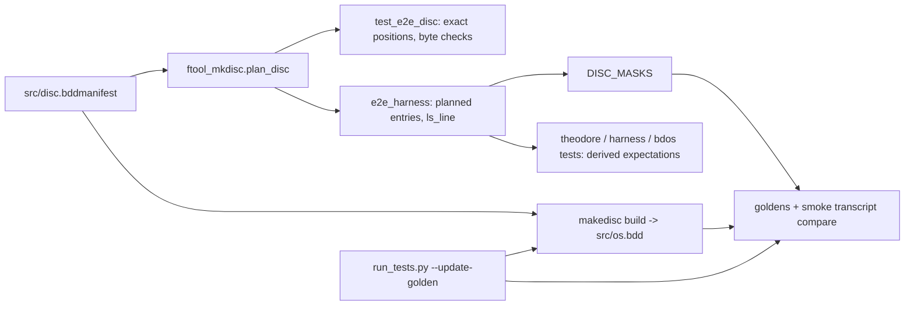
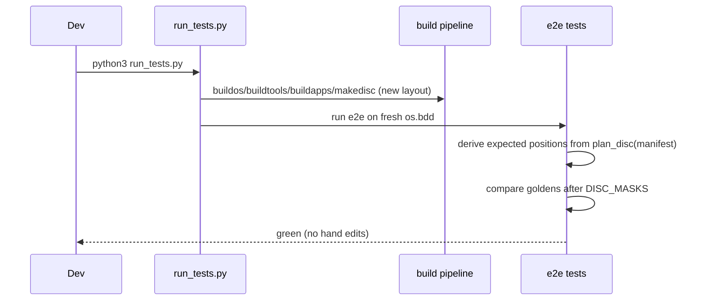

# E2E Tests: Derive Disc Positions from the Manifest Instead of Pinning Tracks/Sectors Plan

**Plan Status**: `FINAL`

**Story Type**: `Internal`

**Plan Revision**: `A0`

> This plan captures **what** to build and **why**. The implementation agent discovers the **how** against live code.

---

## 1. Problem Statement

*   **Context**: Since #37 (PR #88) `ftool mkdisc` places the files of `os.bdd` back to back in `src/disc.bddmanifest` order, so a size change of one program moves every file after it. Several e2e tests and goldens pin exact tracks, sectors, lengths, the free-sector figure and the load progress dots (one dot per 8 sectors loaded). Any program size change therefore turns them red and needs hand edits (seen in #1, #2, #37). Since #92 (PR #94), `os.bdd` and `smoke.bdd` are no longer committed: `run_tests.py` builds the ROM and `os.bdd` before e2e, and every e2e test boots a temp copy of the freshly built `src/os.bdd`. The byte-exact smoke transcript (`src/bc64/testdata/smoke_transcript.txt`) is still committed and still pins the `ls` lines, the free-sector figure and the dots.
*   **Goal**: a program on the system disc can grow or shrink without any test source or golden needing a hand edit. Positions are checked in one place only (`test_e2e_disc` against `ftool_mkdisc.plan_disc()`), everything else derives them from the manifest or masks them, and one command refreshes all e2e testdata.
*   **In scope**: harness masks and layout helpers; derived expectations in the THEODORE, HELLOWRD and `CATALOG_LINES` checks; masking in every golden/transcript of a bdos session on `os.bdd`; a one-command refresh (`run_tests.py --update-golden`); an automated layout-shift regression test; docs.
*   **Out of scope**: fixed slots or track-aligned placement (issue: out of scope); changing bdos/ls output; goldens of `--no-floppy` bcOS sessions (they never touch the disc); the dot lines of test programs that the toolchain and bdio-buffered tests put on the disc themselves (their length depends on the compiler, not on the system-disc layout).

### 1.1 Technical Summary

*   **Touched areas**: `src/tests/e2e_harness.py` (masks, manifest helpers), the e2e test modules in `src/tests/`, goldens in `src/bc64/testdata/e2e/`, `src/bc64/testdata/smoke_transcript.txt`, `run_tests.py`, `.github/workflows/tests.yml`, docs (`src/bc64/CLAUDE.md`, `docs/01-emulator.md`, root `CLAUDE.md`).
*   **New patterns**: a standard mask set `DISC_MASKS` for sessions on the system disc; `ls`-line formatting derived from a manifest entry; a refresh flag on the test runner.
*   **Infrastructure changes**: none (CI's failure-only "regenerate goldens" step switches to the new flag).
*   **End-state observable behaviour**: padding any manifest program by one or more sectors and running `python3 run_tests.py` stays green without edits; `python3 run_tests.py --update-golden` rewrites every e2e golden and the smoke transcript, and a follow-up normal run is green.

---

## 2. Architecture & Design

### 2.1 Architecture Overview

#### Involved components & owners

| Component | Technical Owner |
| :--- | :--- |
| e2e harness and tests (`src/tests/`) | bcichonski |
| test runner (`run_tests.py`) and CI (`.github/workflows/tests.yml`) | bcichonski |

#### C2 diagram

#### Flow diagram (a program grows)

### 2.2 External Contracts & Evidence

`N/A — Internal story`

#### Source Conflict Log

| Topic | Source A | Source B | Conflict | Chosen Handling |
| :--- | :--- | :--- | :--- | :--- |
| Committed discs | Issue AC1 / step 4: "`test_e2e_disc`'s byte checks against the committed discs … until `os.bdd` and `smoke.bdd` are rebuilt"; "refresh `smoke.bdd`" | Repo after #92 (PR #94): `os.bdd`/`smoke.bdd` untracked, `run_tests.py` builds before e2e, `SMOKE_DISK` gone | The "committed discs" and `smoke.bdd` parts no longer exist | AC1 is met in its stronger form: the build happens inside `run_tests.py`, so `test_e2e_disc` is green too. The refresh command covers what is still committed: the goldens and `smoke_transcript.txt`. Not a deviation from the AC's intent (see A1). |

### 2.3 Affected Areas

| Area / File (pointer) | Role in this change | Likely action |
| :--- | :--- | :--- |
| `src/tests/e2e_harness.py` | Session runner, `check_golden(masks=…)`, `apply_masks`, `read_catalog`. | Change: add `MANIFEST`, `DISC_MASKS`, planned-entry lookup, `ls_line` formatter |
| `src/ftool_mkdisc.py` (`plan_disc`, `CatalogEntry` with `number/start/length/attribs/name/ext`, `track`/`sector` properties, `ATTRIBUTES` R=0x01 W=0x02 X=0x04 S=0x80) | The single layout authority. | Reference only |
| `src/tests/test_e2e_bdos.py` | `CATALOG_LINES` pins `ls` lines; goldens `bdos_ls/rm/hellowrd/cat/errors/boot`. | Change |
| `src/tests/test_e2e_theodore.py` | Pins THEODORE at `0x2b/0x0a`. | Change |
| `src/tests/test_e2e_harness.py` | `CatalogTests.test_reader_lists_known_files` pins HELLOWRD `(0x0f, 0x0a, 14, 0x05)`. | Change + new self-tests for the masks |
| `src/tests/test_e2e_disc.py` | Exact structure check (stays the only position check); `disc_ls_all`, `disc_help` goldens. | Change: golden compares use `DISC_MASKS` |
| `src/tests/test_e2e_texted.py` | `texted_roundtrip` golden (TEXTED load dots). | Change: `DISC_MASKS` |
| `src/tests/test_bc64_smoke.py` | Byte-exact transcript compare; own regenerate hint. | Change: masked compare + `BC64_UPDATE_GOLDEN` update mode |
| `src/bc64/testdata/e2e/*.golden.txt`, `src/bc64/testdata/smoke_transcript.txt` | Stored expectations. | Regenerate (masked) |
| `run_tests.py`, `src/tests/test_run_tests.py` | Runner; builds before e2e since #92. | Change: `--update-golden`; new runner tests |
| `.github/workflows/tests.yml` | e2e job's failure-only "Regenerate goldens and collect patch" step regenerates 4 modules by hand. | Change: use the runner flag |
| New `src/tests/test_e2e_layout_shift.py` | Automated proof of AC1. | New |
| `src/bc64/CLAUDE.md`, `docs/01-emulator.md`, root `CLAUDE.md` | Describe goldens/transcript regeneration. | Change |

### 2.4 Key Algorithms & Behaviour

*   **Layout authority.** Exact track/sector/length of system-disc files is asserted only by `test_e2e_disc` (against `plan_disc(src/disc.bddmanifest)`). Every other check that needs a position, length or `ls` line obtains it from `plan_disc()` via the harness. No test outside `test_e2e_disc` contains a hard-coded track or sector of a system-disc file (AC2).
*   **`ls` line format** (as printed by `ls`, verified against `bdos_ls`/`disc_ls_all` goldens): `NAME(8, space padded).EXT(3, space padded) ATTR SIZE TT SS LL`, where `ATTR` is four characters in the order `S R W X` (letter if set, `-` if not; e.g. `SR-X`, `-R-X`, `-RW-`, `SR--`), `SIZE` = length × 128 as 4 upper-case hex digits, `TT`/`SS`/`LL` = track, sector, length as 2 upper-case hex digits. The harness formats this from a planned entry.
*   **`DISC_MASKS`** (ordered `(regex, replacement)` pairs, applied by `check_golden` to both sides):
    1. `ls` entry lines: keep the name, extension and attribute columns verbatim; replace `SIZE TT SS LL` with the fixed placeholder `SIZE TT SS LL`. The regex must only match a complete `ls` entry line (8.3 name, 4-char attribute field of `S`/`R`/`W`/`X`/`-`, then the four hex columns), so names, attributes, order and presence of every line stay compared (AC3).
    2. The free-sector figure in `… catalog entries free; HHHH sectors free...`: replace only the 4 hex digits with `XXXX`. The catalog-entries-free count is not masked (it depends on the number of files, not their size).
    3. Progress-dot lines (a line consisting only of one or more `.`): replace the dots with the placeholder `<dots>`. The line itself remains, so a missing load still shows.
    Output lines in this emulator start with `\r` and end with `\n`; the masks must handle that line shape and must not touch anything else (e.g. `9FF5 bytes free`, the boot `lding` line, text lines that contain dots among other characters such as `with options 10...`).
*   **Where masks apply.** Every golden or transcript comparison of a bdos session booted from `os.bdd` that loads system-disc programs uses `DISC_MASKS`: `test_e2e_bdos` (all goldens), `test_e2e_disc` (`disc_ls_all`, `disc_help`), `test_e2e_texted` (`texted_roundtrip`), `test_bc64_smoke` (transcript). Not applied: `test_e2e_bcos` (`--no-floppy`), `test_e2e_toolchain` and `test_e2e_bdio_buffered` (they compare an extracted fragment whose dots belong to their own test program).
*   **Goldens are stored masked.** Because `check_golden`'s update mode writes the masked actual, regenerated goldens and the transcript contain the placeholders, never stale positions.
*   **Markers stay unmasked.** Marker assertions run on the raw output, and markers built from `plan_disc()` (e.g. the full `ls` line of THEODORE or the `CATALOG_LINES`) keep checking real positions against the current layout.
*   **Refresh command** — `python3 run_tests.py --update-golden`: builds (unless `--no-build`) and runs the e2e suite with `BC64_UPDATE_GOLDEN=1` in that suite's environment only, so every e2e golden and `smoke_transcript.txt` is rewritten from the fresh build. Unit suites are unaffected. Running the default `run_tests.py` afterwards is green. CI's failure-only regenerate step calls this flag instead of naming 4 modules.
*   **Layout-shift test** (automated AC1): in a temp dir, write a copy of the manifest whose source paths point at the real build outputs (absolute paths), except one program in the middle of the manifest (HELLOWRD.PRG, the second file after the fixed area) whose source is a padded copy grown so that both its length and its dot count change (≥ 8 extra zero sectors, zero padding at the end), then build that disc with `ftool_mkdisc.mkdisc`. Assert the shifted plan really moves every later entry. Run the `bdos_ls`, `disc_ls_all` and `bdos_hellowrd` scenarios and the smoke session on it, and compare each with its committed golden / transcript under `DISC_MASKS`; also assert the `ls` lines derived from the shifted plan appear in the raw `ls` output. In update mode (`BC64_UPDATE_GOLDEN=1`) this test must never write a golden (compare-only, or skip).

---

## 3. Key Decisions & Assumptions

*   **D1 — `plan_disc()` is the single authority**; derived checks read the manifest through the harness rather than `read_catalog(os.bdd)`, so they fail if the built disc and the manifest disagree (the built disc is then caught by both the derived checks and `test_e2e_disc`).
*   **D2 — Mask `SIZE` for every `ls` line**, not just "files that can grow": every program can grow, and a per-file list would itself be pinned data. Names and attributes are never masked (AC3).
*   **D3 — Goldens and the smoke transcript are stored masked** (regenerated in this story), so no stored file carries a position.
*   **D4 — Refresh = `run_tests.py --update-golden`** (the runner already builds before e2e since #92). No separate script. The smoke transcript test gains the same `BC64_UPDATE_GOLDEN` update mode so the one command refreshes it too.
*   **D5 — The layout-shift test is part of the regular e2e suite** (a handful of short sessions, a few seconds each), so AC1 stays proven over time and not only by a manual check.
*   **D6 — Mask scope** as in §2.4 "Where masks apply"; toolchain/bdio-buffered/bcos goldens stay unmasked.
*   **A1 (assumption, not a deviation)** — AC1's "until `os.bdd` and `smoke.bdd` are rebuilt" and step 4's "refresh `smoke.bdd`" refer to files #92 stopped committing. The AC is satisfied in its strict form: with a padded program, `python3 run_tests.py` (which rebuilds) is fully green, including `test_e2e_disc`, without a refresh; after `--update-golden`, it is green and goldens show no diff. The PR body will say this.

### 3.1 Decision Lock (Constants & Policies)

| Constant / Policy | Selected Value | Why | Where it lives |
| :--- | :--- | :--- | :--- |
| Mask set name | `DISC_MASKS` | One standard set for all system-disc sessions | `src/tests/e2e_harness.py` |
| `ls` placeholder | `SIZE TT SS LL` | Readable, mirrors the column names | `DISC_MASKS` |
| Free-sector placeholder | `XXXX` (in `; XXXX sectors free...`) | Keeps the sentence | `DISC_MASKS` |
| Dot-line placeholder | `<dots>` | Line stays visible | `DISC_MASKS` |
| Manifest path constant | `MANIFEST` = `src/disc.bddmanifest` | Shared by tests | `src/tests/e2e_harness.py` |
| Refresh flag | `run_tests.py --update-golden` | Builds + regenerates in one command | `run_tests.py` |
| Grown program in shift test | `HELLOWRD.PRG`, ≥ 8 extra sectors | Middle of the manifest; changes length and dots | `src/tests/test_e2e_layout_shift.py` |

### 3.2 Open Questions

No open questions.

---

## 4. Task Breakdown

| Task | Title | Depends on | Complexity |
| :--- | :--- | :--- | :--- |
| `T1` | Harness: `DISC_MASKS`, manifest helpers, `ls_line`; derive HELLOWRD in the harness self-test | — | `Medium` |
| `T2` | Derived expectations and masked goldens in the e2e modules and the smoke test; regenerate stored goldens | `T1` | `Medium` |
| `T3` | `run_tests.py --update-golden` and CI regenerate step | — | `Medium` |
| `T4` | Layout-shift e2e test (automated AC1) | `T1`, `T2` | `Medium` |
| `T5` | Docs: masks, derived expectations and the refresh command | `T2`, `T3`, `T4` | `Low` |

### T1 — Harness: `DISC_MASKS`, manifest helpers, `ls_line`

*   **Goal**: the harness offers the standard masks for system-disc sessions and helpers to get planned entries and their `ls` line from the manifest.
*   **Depends on**: —
*   **Complexity**: `Medium`
*   **Pointers**: `src/tests/e2e_harness.py`; `src/ftool_mkdisc.py` (`plan_disc`, `CatalogEntry`, `ATTRIBUTES`); goldens `bdos_ls`, `disc_ls_all` show the exact `ls` format; `src/tests/test_e2e_harness.py`.
*   **Definition of Done**:
    *   `e2e_harness` exposes `MANIFEST`, `DISC_MASKS` (§2.4, §3.1), a way to get all planned entries and one entry by name/ext from `plan_disc(MANIFEST)` (accepting an alternative manifest path, needed by T4), and `ls_line(entry)` producing the exact `ls` line (§2.4).
    *   `CatalogTests.test_reader_lists_known_files` derives HELLOWRD's track, sector, length and attributes from the plan instead of constants.
    *   `ls_line` of every planned entry equals the corresponding line in the current `disc_ls_all` output (proved by a test, either here on the built disc or in T2).
*   **Tests expected** (e2e group, `src/tests/test_e2e_harness.py`, new tests): masks replace only the layout numbers of an `ls` line, the free-sector figure and dot-only lines; a golden still fails on a missing `ls` line, a wrong attribute, a renamed file, a changed entry order, and a removed dot line; masks leave `9FF5 bytes free`, `booting from FDDlding` and `with options 10...` untouched; `ls_line` formats known entries (system file `SR-X`, `-RW-` data file, `SR--` boot) correctly.
*   **Tests to modify**:
    *   `src/tests/e2e_harness.py` — add the constants and helpers (test-support module; behaviour of existing functions unchanged) (AC2, AC3).
    *   `src/tests/test_e2e_harness.py :: CatalogTests.test_reader_lists_known_files` — HELLOWRD position must come from the manifest, not constants (AC2).

### T2 — Derived expectations and masked goldens

*   **Goal**: no e2e test outside `test_e2e_disc` pins a system-disc position, and every system-disc golden/transcript compare uses `DISC_MASKS`; the stored goldens and transcript are regenerated masked.
*   **Depends on**: `T1`
*   **Complexity**: `Medium`
*   **Pointers**: `src/tests/test_e2e_bdos.py` (`CATALOG_LINES`, `check`), `src/tests/test_e2e_theodore.py` (`test_catalog_entry_and_ls`, `test_ls_lists_theodore`), `src/tests/test_e2e_disc.py` (`DiscSessionTests`), `src/tests/test_e2e_texted.py` (`TextedRoundTripTests.test_save_restart_load_prints_same_lines`), `src/tests/test_bc64_smoke.py`, `src/bc64/testdata/e2e/`, `src/bc64/testdata/smoke_transcript.txt`.
*   **Definition of Done**:
    *   `CATALOG_LINES` (non-system files shown by plain `ls`: HELLOWRD, TEXTED, TEST.B, THEODORE, in manifest order) is built from the plan with `ls_line`; markers keep checking the full real lines.
    *   THEODORE's expected track/sector (and its `ls` line) come from the plan; the length check against `theodore.sectors` stays.
    *   All `check_golden` calls in `test_e2e_bdos`, `test_e2e_disc` (`disc_ls_all`, `disc_help`) and `test_e2e_texted` (`texted_roundtrip`) pass `DISC_MASKS`.
    *   `test_bc64_smoke`'s transcript test compares under `DISC_MASKS` and supports `BC64_UPDATE_GOLDEN=1` (writes the masked transcript and passes, like `check_golden`); its regenerate hint names the env var / refresh command instead of the manual `bc64.py` command line. Its markers stay.
    *   Goldens `bdos_ls`, `bdos_rm`, `bdos_hellowrd`, `bdos_cat`, `bdos_errors`, `bdos_boot`, `disc_ls_all`, `disc_help`, `texted_roundtrip` and `smoke_transcript.txt` regenerated with `BC64_UPDATE_GOLDEN=1`; the diff shows only placeholder substitutions (no names, attributes, order or behaviour lines changed).
    *   `grep` of `src/tests/` (outside `test_e2e_disc.py`) finds no hard-coded track/sector of a system-disc file (AC2).
    *   `python3 run_tests.py` is green.
*   **Tests expected**: existing behaviour preserved; add a test (e2e) that `CATALOG_LINES`/`ls_line` agree with the `ls` lines of the built disc if T1 did not already.
*   **Tests to modify**:
    *   `src/tests/test_e2e_bdos.py` — `CATALOG_LINES` derived from the plan; `BdosShellTests.check` passes `DISC_MASKS` (affects `test_ls_lists_catalog`, `test_rm_removes_file_from_ls_and_catalog`, `test_hellowrd_prints_greeting`, `test_cat_prints_text_file`, `test_error_paths`, `test_boot_prompt_and_exit`) (AC1, AC2).
    *   `src/tests/test_e2e_theodore.py :: TheodoreTests.test_catalog_entry_and_ls`, `TheodoreTests.test_ls_lists_theodore` — position from the plan (AC2).
    *   `src/tests/test_e2e_disc.py :: DiscSessionTests.test_ls_all_lists_every_file`, `DiscSessionTests.test_every_utility_prints_usage_and_returns_to_shell` — golden compare with `DISC_MASKS` (AC1).
    *   `src/tests/test_e2e_texted.py :: TextedRoundTripTests.test_save_restart_load_prints_same_lines` — golden compare with `DISC_MASKS` (TEXTED dots) (AC1).
    *   `src/tests/test_bc64_smoke.py :: SmokeSessionTests.test_built_disc_session_matches_transcript` (+ module docstring, `REGENERATE`) — masked compare and update mode (AC1, D4).
    *   Goldens: `src/bc64/testdata/e2e/{bdos_ls,bdos_rm,bdos_hellowrd,bdos_cat,bdos_errors,bdos_boot,disc_ls_all,disc_help,texted_roundtrip}.golden.txt` and `src/bc64/testdata/smoke_transcript.txt` — stored masked (D3).

### T3 — `run_tests.py --update-golden` and CI

*   **Goal**: one command rebuilds and refreshes all e2e testdata.
*   **Depends on**: —
*   **Complexity**: `Medium`
*   **Pointers**: `run_tests.py` (`main`, `run_suite`, module docstring), `src/tests/test_run_tests.py`, `.github/workflows/tests.yml` (step "Regenerate goldens and collect patch").
*   **Definition of Done**:
    *   `--update-golden` sets `BC64_UPDATE_GOLDEN=1` for the e2e suite's process only (unit suites run without it; the parent environment is not changed for other suites), keeps building before e2e unless `--no-build`, and is documented in `--help` and the module docstring.
    *   Without the flag, behaviour is unchanged (e2e suite does not get `BC64_UPDATE_GOLDEN` from the runner).
    *   CI's failure-only regenerate step runs `python run_tests.py --group e2e --no-build --update-golden < /dev/null` (or equivalent) and still collects the patch of `src/bc64/testdata/`; the workflow stays valid (actionlint via `docker run --rm -v "$PWD":/repo -w /repo rhysd/actionlint` if available).
    *   Existing `test_run_tests.py` tests pass unchanged.
*   **Tests expected** (unit/e2e group per where `test_run_tests.py` runs; new tests only): with the flag, the e2e suite runner sees `BC64_UPDATE_GOLDEN=1` and unit suites do not; without the flag, no suite gets it; the flag still builds before e2e and respects `--no-build`.
*   **Tests to modify**: None

### T4 — Layout-shift e2e test

*   **Goal**: an automated test proves that growing a program in the middle of the manifest leaves the golden scenarios and derived checks green (AC1).
*   **Depends on**: `T1`, `T2`
*   **Complexity**: `Medium`
*   **Pointers**: new `src/tests/test_e2e_layout_shift.py`; `src/ftool_mkdisc.py` (`parse_manifest` joins source paths with the manifest folder, so absolute paths work; `mkdisc(manifest, out)`); `e2e_harness.run_session`, `check_golden`/`apply_masks`, `DISC_MASKS`; goldens `bdos_ls`, `disc_ls_all`, `bdos_hellowrd`; `test_bc64_smoke` session/transcript.
*   **Definition of Done**: as in §2.4 "Layout-shift test": temp manifest + padded HELLOWRD source (≥ 8 extra sectors so the dot count changes), shifted disc built in a temp dir, assertion that every entry after HELLOWRD moved and HELLOWRD's dot count differs from the real disc, the three scenarios + smoke session match their committed goldens/transcript under `DISC_MASKS`, derived `ls` lines of the shifted plan appear in the raw output. Never writes goldens in update mode. Leaves no files in the repo (temp dirs only; CI's clean-tree guard must stay green). Runs in the e2e suite in a few seconds per session.
*   **Tests expected**: the new module itself (e2e group).
*   **Tests to modify**: None

### T5 — Docs

*   **Goal**: the docs describe the masks, the derived expectations and the refresh command (AC4).
*   **Depends on**: `T2`, `T3`, `T4`
*   **Complexity**: `Low`
*   **Pointers**: `src/bc64/CLAUDE.md` ("End-to-end (smoke) tests", "End-to-end scenarios"), `docs/01-emulator.md` ("Regenerating goldens" and around), root `CLAUDE.md` (test section, CI notes).
*   **Definition of Done**: both required docs (and the root `CLAUDE.md` where it explains regeneration) state: `test_e2e_disc` is the only exact-position check; other tests derive positions from `plan_disc()` via the harness; what `DISC_MASKS` masks and what it never masks (names, attributes, order, presence); goldens and the transcript are stored masked; `python3 run_tests.py --update-golden` rebuilds and refreshes all e2e goldens and the smoke transcript, then review the diff; the manual `bc64.py` transcript command is replaced by the flag; the layout-shift test exists.
*   **Tests expected**: none (docs only).
*   **Tests to modify**: None

---

## 5. Verification

*   **Full suite**: `python3 run_tests.py < /dev/null` from the repo root — `ALL PASSED` (builds first).
*   **Python 3.10**: `docker run --rm -v "$PWD":/w -w /w python:3.10-slim` (copy the repo inside, `pip install -e .`, run `python run_tests.py --group unit`) if the runner changes touch syntax.
*   **Manual AC1 check** (in a temp copy of the repo): append 9 zero sectors (1152 bytes) to the built `src/bdos/helloworld.sectors` after a build, run `python3 run_tests.py --no-build` after `cd src && ./makedisc` → green; run `python3 run_tests.py --update-golden --no-build` → `git status` shows no golden/transcript change; then the normal run is green.
*   **AC2**: grep `src/tests/` for `0x2b`, `0x0f, 0x0a`, `2B 0A`, `0F 0A` and similar position literals outside `test_e2e_disc.py` → none.
*   **AC3**: the T1 harness self-tests (missing line / wrong attribute / renamed file still fail).
*   **Clean tree**: after the full run, `git status --porcelain` is empty (CI e2e guard).

---

## 6. Fact-Integrity Checklist

| Check | Yes / No / N/A | Notes |
| :--- | :--- | :--- |
| External contracts verified from producer/contract source | N/A | Internal |
| Evidence sources are reproducible | N/A | Internal |
| Identifier directionality / ordering / freshness meaning evidenced | N/A | Internal |
| Every `Assumption` is linked to an Open Question (§3.2) | Yes | A1 is resolved from the repo state after #92, not open |
| No unresolved Open Questions (for `FINAL`) | Yes | |
| Each Decision states a single committed approach | Yes | |
| Tasks are independent, each with a Definition of Done and test expectations | Yes | T2/T3 parallel after T1; T4 after T2 |
| Required infra reflected | N/A | No toggle, no infra |

**Self-review note**: The `ls` format, attribute letter order (`S R W X`) and `SIZE = length × 128` were checked against the committed `bdos_ls`/`disc_ls_all` goldens; the agent should still verify `ls_line` against a live `ls -a` run. Mask regexes are the risky part: they must match only whole `ls` entry lines and dot-only lines in the `\r…\n` line shape, so the T1 self-tests must prove AC3 with negative cases. The smoke test is a standalone module (its own `run_session`); keep its two tests and markers, and only change the transcript compare/update path.

---

## 7. Amendment Log

| Amendment | Request | Decision | Plan changes |
| :--- | :--- | :--- | :--- |
