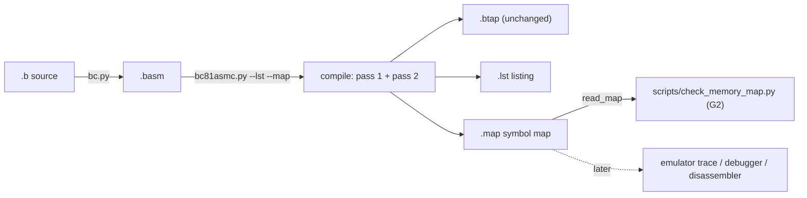

# Assembler Listing (--lst) and Symbol Map (--map) Plan

**Plan Status**: `FINAL`

**Story Type**: `Internal`

**Plan Revision**: `A0`

> This plan captures **what** to build and **why**: domain, architecture, decisions, and verified facts.
> It contains no implementation code. The implementation agent discovers the **how** against live code.

Issue: [bcichonski/bc16#9](https://github.com/bcichonski/bc16/issues/9) "Assembler modernisation: listing (--lst) and symbol map (--map) output". Points: 5.

---

## 1. Problem Statement

*   **Context**: `bc81asmc` writes only a `.btap`. A label's address can be read only from the `--verbose` pass-1 trace (which prints addresses *before* pass-2 patching and mixes in fix-up noise). Nothing gives a reviewable, machine-readable record of the memory map (design decision G2), and later tools (emulator trace with symbols, a debugger, the disassembler #5, BASM encoder tests in the self-hosting roadmap) have no symbol source.
*   **Goal**: two optional assembler outputs, a **listing** (`--lst FILE`) and a **symbol map** (`--map FILE`), in a simple, stable text format. The build scripts write them next to every `.btap`. A check confirms the G2 fixed addresses from the maps of a fresh build.
*   **In scope**: assembler CLI flags and writers; a map reader for other tools and tests; build scripts (`buildos`, `bcc`, the `bcc` console command) passing the flags; `.gitignore`; the G2 check; docs (`docs/02-assembler.md`, design decisions, root `CLAUDE.md`, `src/bc81asmc/CLAUDE.md`).
*   **Out of scope**: using the map in the emulator trace/debugger (later stories, #5); a by-name section in the map (the AC says "optionally"; a reader can sort); `.lst`/`.map` for `debug`, `fddtest`, `src/bc/code/*` beyond what `./bcc` gives them for free; changing any emitted byte.

### 1.1 Technical Summary

*   **Touched projects**: `src/bc81asmc/` (CLI + a new listing/map module), `src/buildos`, `src/bcc`, `src/bc64_toolchain.py` (`bcc` command), `.gitignore`, a new `scripts/check_memory_map.py`, docs.
*   **New patterns**: `compile()` keeps a per-source-line record (address span) and its symbol tables on the returned `CodeContext`; pure formatter functions turn them into text after pass 2, so the listing shows the final, patched bytes.
*   **Infrastructure changes**: `None`.
*   **End-state observable behaviour**: `cd src && ./buildos && ./buildtools && ./buildapps` leaves `bcos.lst/.map`, `boot.lst/.map`, `bdos.lst/.map` and `<app>.lst/.map` next to each `.btap`, all git-ignored; `python3 scripts/check_memory_map.py` passes on that tree; every `.btap`, `.b81`, `.sector(s)` and `.bdd` is byte-identical to a build without the flags.

---

## 2. Architecture & Design

### 2.1 Architecture Overview

#### Involved services & owners

| Component | Technical Owner |
| :--- | :--- |
| `bc81asmc` assembler | bcichonski |
| build scripts / `bc64_toolchain` launcher | bcichonski |

#### C2 diagram



#### Flow diagram

```mermaid
sequenceDiagram
  participant CLI as bc81asmc main()
  participant C as compile()
  participant F as listing/map formatter
  CLI->>C: AST (each node has lineno, source)
  C->>C: pass 1: emit, record (lineno, start addr, end addr) per node; labels + .def table
  C->>C: pass 2: patch label bytes; evaluate .assert
  C-->>CLI: CodeContext (+ line records, symbols)
  CLI->>CLI: write .btap (as today)
  CLI->>F: source text + records + final bytes
  F-->>CLI: listing text / map text
  CLI->>CLI: write FILE.lst / FILE.map (only when the flag is given)
```

### 2.2 External Contracts & Evidence

N/A — Internal story.

#### Source Conflict Log

| Topic | Source A | Source B | Conflict | Chosen Handling |
| :--- | :--- | :--- | :--- | :--- |
| Are `.lst`/`.map` committed? | Issue #9 "Decision (owner)": committed "like the other build outputs (G3)"; AC-4 "are committed"; AC-5 "G3 ... lists `.lst`/`.map` among the committed outputs" | `docs/specs/memory/design-decisions.md` G3 is **superseded** by G12 (#90, #92, merged after the issue was written): "Only sources are committed"; every build output is ignored, and CI fails when an ignored file is tracked or `git status` is dirty after the build | The issue's decision rests on G3, which no longer exists as a rule. Committing them would also mean ~9k-line `bdos.lst` churn on every compiler change, which is exactly what G12 removed. | **Follow G12** (D1): `.lst`/`.map` are ignored build outputs, listed in G12 next to `.btap`. The owner's real goal (an exact memory map, and any move of a G2 address surfacing in review) is met by a check that **fails** on a fresh build when a G2 address moves (D6), which is stricter than a diff a reviewer has to notice. Flagged in the PR as an AC deviation (AC-4 "committed", AC-5 "G3 lists"). Reversible: un-ignore and commit later if the owner still wants it. |

### 2.3 Affected Areas

| Area / File (pointer) | Role in this change | Likely action |
| :--- | :--- | :--- |
| `src/bc81asmc/bc81asmc.py` | CLI (`argparse`), `compile()` (pass 1/2), `.btap` writer | Change: new flags; record line spans + symbols on the context; write the two files after the `.btap` |
| `src/bc81asmc/bc81asmc_ast.py` (`CodeContext`, `ORG`, `DB`, `MV`, `DEF`, `LabelOnly`, `LineComment`) | byte emission, nibble packing (`emit_4bit`), `set_addr` for `.org`, `.def` constants in `context.defs` | Reference (maybe a field on `CodeContext`) |
| `src/bc81asmc/bc81asmc_grammar.py` (`positioned`, `line`, `program`) | every AST node carries `lineno` (1-based) and `source`; blank lines produce no node | Reference |
| new `src/bc81asmc/bc81asmc_listing.py` | formatters (listing, map) and the map reader | New |
| `src/bc81asmc/tests/` | assembler unit + CLI tests | New test module(s) |
| `src/bc81asmc/tests/bc81asmc_contract_tests.py` | today asserts G2 for bcOS by appending `.assert` lines in memory | Reference (keep) |
| `src/buildos`, `src/bcc` | build scripts calling the assembler for bcOS, boot, and every B program | Change: pass `--lst`/`--map` |
| `src/bc64_toolchain.py` (`bcc()`) and `src/tests/test_bc64_toolchain.py` | the `bcc` console command mirrors `./bcc` | Change + new test |
| `.gitignore` (BC64 build-outputs block) | ignores build outputs | Change: `*.lst`, `*.map` |
| new `scripts/check_memory_map.py`, `scripts/tests/` | G2 check over a built tree, and its test | New |
| `scripts/code_size.py` | example of "build every program in a temp copy, standard library only"; program rule = `.b` directly in `src/bdos/` that defines `main` | Reference |
| `docs/02-assembler.md`, `docs/specs/memory/design-decisions.md` (G2, G12), root `CLAUDE.md`, `src/bc81asmc/CLAUDE.md` | docs | Change |

### 2.4 Key Algorithms & Behaviour

*   **Line records.** In pass 1, for each AST node, remember its `lineno`, the address before `emit` and the address after it. The bytes a line owns are `context.bytes[start - org : end - org]` read **after pass 2**, so placeholders (`0xfa`) are already patched. A line that fails to encode produces a diagnostic, and no listing is written (the run fails as today).
*   **Nibbles.** `emit_4bit` completes a byte only on the second nibble. Every instruction is expected to end byte-aligned; if a line ends half-emitted, the completed byte belongs to the line that completes it. Do not change emission.
*   **`.org`.** `.org` sets `startaddr`/`curraddr`; it emits no byte. Its listing row shows the new address.
*   **Symbols.** Labels: `name → address` from pass 1 (including label-only lines, which take the next emitted address, or the end address at end of file). `.def` constants: `name → value` from `context.defs`. They share a namespace (duplicates are already errors), so each name appears once.
*   **End of image.** `end = org + len(bytes)` (the first address past the image).
*   **No flags → no change.** Without `--lst`/`--map`, the `.btap`, stdout and stderr are exactly as today. With them, the `.btap` is byte-identical; the only extra stdout is one `Saving output file <name>...` line per extra file (same wording as the `.btap` line).
*   **Errors.** On any assembler error no `.lst`/`.map` is written (as no `.btap` is written today). An unwritable output path is an ordinary Python error exit; no special handling.
*   **Exactness of the memory map (G2).** `scripts/check_memory_map.py` reads maps from a built tree and checks the G2 table (§3.1). It exits 0 when everything holds, 1 with one line per violation or missing map. It never builds anything itself.

---

## 3. Key Decisions & Assumptions

*   **D1 — `.lst`/`.map` are git-ignored build outputs (G12), not committed.** See the Source Conflict Log. G12 gets them in its list of ignored outputs; G3 stays as history. The PR states this deviation from AC-4/AC-5 explicitly.
*   **D2 — Map format** (§3.1): plain text, one symbol per line, sorted by value then name; `;` lines are comments/header. No by-name section (optional in the issue; a reader sorts).
*   **D3 — Listing format** (§3.1): one row per source line, in source order, including blank and comment-only lines, so the listing reads like the source; a `.db` longer than 4 bytes continues on extra rows that hold only address and bytes.
*   **D4 — Flag form**: `--lst FILE` and `--map FILE` take an explicit path (the issue's wording). The build scripts pass `<name>.lst` / `<name>.map` next to the `.btap`. `--btap` stays a no-op.
*   **D5 — Keep `compile(ast, verbose)`'s signature and return value** (a `CodeContext`): many tests call it. The records and symbols become attributes on the returned context. The formatters live in a new module `bc81asmc_listing.py` (no printing, no file I/O), with a `read_map(text)` that returns the symbols (name, value, kind) plus the header values (org, end) — the reader other tools use.
*   **D6 — G2 is checked by a script on a built tree plus a unit test that builds fresh maps.** `scripts/check_memory_map.py` (standard library only, `--root DIR` like `code_size.py`) checks the built tree; `scripts/tests/` gets a test that assembles bcOS and boot and compiles + assembles bdos and every program in `src/bdos/` that defines `main` (code_size.py's rule) into a temp copy with `--map`, then runs the check on it (expect pass), plus failing cases on hand-written maps (each rule trips). Building in a temp copy keeps the repo tree untouched; run the builds in parallel (subprocesses) to keep the test to seconds. The existing in-memory `.assert` contract tests stay.
*   **D7 — Byte-identity is tested, and a full rebuild is checked by hand.** Unit/CLI tests prove the flags do not change the `.btap` for bcOS, boot and a compiled program. The full rebuild before/after (every `.btap`, `.b81`, `.sector(s)`, `.bdd`) is a manual §5 check, not a test (the owner rejected an automated full-rebuild-vs-outputs test in #86).
*   **D8 — Tests do not parse docs** (owner rule from #5): the G2 values live in the script/test code, not read from `design-decisions.md`.
*   **Assumption (low stakes, no OQ):** "bcOS ends below `0x0d80`" is checked as `user_mem <= 0x0d80` (the label bcOS uses for the end of its code, as in `bc81asmc_contract_tests.py`) and the map's end address `<= 0x0d80`; "bdos ending below `0x5d00`" as `sys_codeend < 0x5d00` (same as bdos.b's `#codelimit`).

### 3.1 Decision Lock (Constants & Policies)

| Constant / Policy | Selected Value | Why | Where it lives |
| :--- | :--- | :--- | :--- |
| Map header | line 1 `; bc81asmc map <source file name>`; line 2 `; org 0xHHHH end 0xHHHH` (lowercase hex, 4 digits) | org/end let a reader check image bounds without the `.btap` | `bc81asmc_listing.py` |
| Map symbol line | `0xHHHH <kind> <name>`, single spaces, `kind` is `label` or `def` | three whitespace-separated fields: trivial to read in any language (incl. BASM later) | `bc81asmc_listing.py` |
| Map order | by value, then by name | "sorted by address" (AC); name tiebreak makes it stable | same |
| Listing row | `HHHH  HH HH HH HH  <source line>`: 4-hex address (no `0x`), two spaces, bytes column padded to 4 bytes (11 chars), two spaces, the source line with trailing whitespace stripped | fixed columns, readable, diffable | same |
| Listing address column | shown when the line emits bytes, carries a label, or is `.org`; blank (spaces) otherwise | comments/blank/`.def`/`.assert` lines have no location of their own | same |
| Bytes per listing row | 4; longer `.db` continues on rows with address + bytes only | the longest instruction (`.mv`) is 4 bytes, so only `.db` wraps | same |
| Line endings | `\n`, UTF-8 | matches `bc.py`'s `.basm` output | same |
| Build-script file names | `<dir>/<name>.lst`, `<dir>/<name>.map` next to `<name>.btap` | "next to the .btap" (issue) | `src/buildos`, `src/bcc`, `bc64_toolchain.bcc()` |
| G2 table checked | `os_metacall = 0x0008`, `os_metatab = 0x000c`, bcOS org `0x0000` and `user_mem <= 0x0d80` and end `<= 0x0d80`; boot org `0x0e00`, `bd_end <= 0x0e80`; bdos org `0x0f00`, `sys_codeend < 0x5d00`; every other program org `0x6000` | issue "Decision (owner)" + G2 | `scripts/check_memory_map.py` |
| Map locations the script reads | `src/bc81asmc/bcOS/bcos.map`, `src/bdos/boot.map`, `src/bdos/bdos.map`, and every other `src/bdos/*.map` as a program | where the build scripts write them | same |
| Ignore rules | `*.lst` and `*.map` in the BC64 build-outputs block of `.gitignore` | G12 | `.gitignore` |

### 3.2 Open Questions

No open questions. The one conflict (commit vs ignore) is resolved by the later owner decision G12 and logged in §2.2; it is flagged in the PR.

---

## 4. Task Breakdown

| Task | Title | Depends on | Complexity |
| :--- | :--- | :--- | :--- |
| `T1` | Assembler: `--lst`/`--map` output and map reader | — | `Medium` |
| `T2` | Build scripts, `bcc` command and `.gitignore` | `T1` | `Low` |
| `T3` | G2 memory-map check script and its test | `T1` | `Medium` |
| `T4` | Docs: assembler doc, design decisions, CLAUDE.md files | `T1`, `T2`, `T3` | `Low` |

### T1 — Assembler: `--lst`/`--map` output and map reader

*   **Goal**: `bc81asmc.py file.basm --lst out.lst --map out.map` writes the listing and the symbol map in the §3.1 formats, from the final patched bytes; without the flags nothing changes.
*   **Depends on**: —
*   **Complexity**: `Medium`
*   **Pointers**: `src/bc81asmc/bc81asmc.py` (`main`, `compile`), `bc81asmc_ast.py` (`CodeContext`, `ORG`, `DB`, `DEF`, `LabelOnly`), `bc81asmc_grammar.py` (`positioned`), new `src/bc81asmc/bc81asmc_listing.py`, tests in `src/bc81asmc/tests/` (new module, e.g. `bc81asmc_listing_tests.py`, `*_tests.py` naming so `run_tests.py` finds it).
*   **Definition of Done**:
    *   both flags exist and take a path; files are written only on success, after the `.btap`;
    *   `compile()` signature/return unchanged; the context carries the line records and symbols;
    *   `bc81asmc_listing.py` has the listing formatter, the map formatter and `read_map`; `read_map(format_map(...))` round-trips;
    *   formats exactly as in §3.1;
    *   `.btap` bytes and stdout/stderr without the flags are unchanged (existing CLI tests keep passing untouched).
*   **Tests expected** (unit + CLI subprocess, all in `src/bc81asmc/tests/`):
    *   map: labels and `.def`s both listed with the right kind, sorted by value then name; a label-only line at end of file gets the end address; header org/end;
    *   listing: a forward reference shows the **patched** bytes, not `fa`; `.mv` (4 bytes) on one row; a `.db` of >4 bytes wraps; comment-only and blank lines appear with blank address/bytes; `.org` row shows its address; every source line appears once, in order;
    *   the concatenated listing bytes equal the `.btap` image for `bcos.basm` and `boot.basm`; their maps give `os_metacall = 0x0008`, `os_metatab = 0x000c`, boot org `0x0e00`;
    *   CLI: no flags → no `.lst`/`.map` and the same `.btap` bytes and stdout as before; with flags → both files, `.btap` byte-identical to the no-flag run; an assembler error → exit 1 and neither file written.
*   **Tests to modify**: None

### T2 — Build scripts, `bcc` command and `.gitignore`

*   **Goal**: a normal build writes `.lst`/`.map` next to every `.btap`, and they never show up in `git status`.
*   **Depends on**: `T1`
*   **Complexity**: `Low`
*   **Pointers**: `src/buildos` (bcOS and boot assembler calls), `src/bcc` (assembles every B program, including bdos), `src/bc64_toolchain.py` `bcc()`, `src/tests/test_bc64_toolchain.py`, `.gitignore`. Keep the scripts LF and executable (`.gitattributes`, mode 100755).
*   **Definition of Done**:
    *   `./buildos` writes `bc81asmc/bcOS/bcos.{lst,map}` and `bdos/boot.{lst,map}`; `./bcc path/name` and the `bcc` console command write `path/name.{lst,map}`;
    *   `.gitignore` ignores `*.lst` and `*.map`; after `cd src && ./buildos && ./buildtools && ./buildapps && ./makedisc` `git status --porcelain` is empty and `git ls-files -i -c --exclude-standard` prints nothing;
    *   every `.btap`, `.b81`, `.sector(s)`, `.bdd` from the build is byte-identical to a build of the base commit (check by hand, as in §5; report the result).
*   **Tests expected**: a `test_bc64_toolchain` test that the `bcc` console command writes `name.lst` and `name.map` next to `name.btap` (and its `.btap` matches the script path as the existing tests do).
*   **Tests to modify**: None

### T3 — G2 memory-map check script and its test

*   **Goal**: `python3 scripts/check_memory_map.py [--root DIR]` checks the maps of a built tree against the G2 table and fails on any moved address or missing map.
*   **Depends on**: `T1` (uses `read_map`'s format; the script stays standard library only, so it parses the map format itself or loads `bc81asmc_listing.py` by path — the implementer chooses; either way the format is the §3.1 one)
*   **Complexity**: `Medium`
*   **Pointers**: new `scripts/check_memory_map.py`, `scripts/code_size.py` (temp-copy build pattern, `--root`, program rule), new test in `scripts/tests/` (e.g. `test_check_memory_map.py`, matching `test_code_size.py`).
*   **Definition of Done**:
    *   checks every row of the §3.1 G2 table; prints one line per violation (map, symbol, expected, actual) and exits 1; prints a short OK summary and exits 0 otherwise; a missing required map (bcOS, boot, bdos) is a violation; at least one program map must exist;
    *   no build, no writes to the tree.
*   **Tests expected** (unit, `scripts/tests/`):
    *   fresh build in a temp copy (bcOS, boot, bdos and every `main`-defining program in `src/bdos/`, built with `--map`, in parallel) → the check passes;
    *   failing cases on synthetic maps: `os_metacall` moved, bcOS end past `0x0d80`, `bd_end` past `0x0e80`, bdos `sys_codeend` at/after `0x5d00`, a program not at `0x6000`, a missing bdos map → exit 1 naming the problem.
*   **Tests to modify**: None

### T4 — Docs: assembler doc, design decisions, CLAUDE.md files

*   **Goal**: the formats and the rules are documented where people look.
*   **Depends on**: `T1`, `T2`, `T3`
*   **Complexity**: `Low`
*   **Pointers**: `docs/02-assembler.md` (Usage, a new "`.lst` and `.map` output formats" subsection next to "`.btap` output format"), `docs/specs/memory/design-decisions.md` (G12's ignored list gets `.lst`/`.map`; G2's "checked at build time" paragraph mentions the maps and `scripts/check_memory_map.py`), root `CLAUDE.md` (the pipeline diagram / ignored outputs list), `src/bc81asmc/CLAUDE.md` (Commands, How it works).
*   **Definition of Done**: both formats documented with a short example each (taken from a real build); G12 lists them as ignored outputs; G2 says how the map is checked; CLAUDE.md files mention the flags, the files and the check command. No test reads docs (D8).
*   **Tests expected**: none (docs only).
*   **Tests to modify**: None

---

## 5. Verification

*   **Unit**: `python3 run_tests.py --group unit` — all green.
*   **E2E**: `python3 run_tests.py --group e2e --tier happy` and `--changed origin/master` during development; the full `python3 run_tests.py < /dev/null` once before the push. The e2e build must leave `git status` clean.
*   **Memory map**: `cd src && ./buildos && ./buildtools && ./buildapps && ./makedisc && cd .. && python3 scripts/check_memory_map.py` → OK.
*   **Byte identity (manual)**: build the base commit and this branch in two temp copies (`./buildos && ./buildtools && ./buildapps && ./makedisc`) and compare every `.btap`, `.b81`, `.sector(s)`, `.bdd` → identical.
*   **Observable**: open `src/bdos/bdos.map` and `src/bc81asmc/bcOS/bcos.lst` and spot-check a few addresses against `--verbose`.

---

## 6. Fact-Integrity Checklist

| Check | Yes / No / N/A | Notes |
| :--- | :--- | :--- |
| External contracts verified from producer/contract source | N/A | Internal |
| Evidence sources are reproducible | N/A | Internal |
| Identifier directionality / ordering / freshness meaning evidenced | N/A | Internal |
| Every `Assumption` is linked to an Open Question (§3.2) | Yes | the one assumption (which labels mark the end of bcOS/bdos) is low stakes and taken from existing asserts; no OQ needed |
| No unresolved Open Questions (for `FINAL`) | Yes | |
| Each Decision states a single committed approach | Yes | |
| Tasks are independent, each with a Definition of Done and test expectations | Yes | |
| Required infra reflected | N/A | no toggles, no infra |

**Self-review note**: The main judgment call is D1: the issue's "commit `.lst`/`.map`" rests on G3, which G12 (#90/#92) superseded after the issue was written, and CI enforces G12. The plan follows G12 and makes the G2 check fail on a moved address instead; the PR must call this out. Care points for the implementer: list the **patched** bytes (read after pass 2), keep the no-flag output byte- and text-identical, and keep `compile()`'s signature because many tests call it directly.

---

## 7. Amendment Log

| Amendment | Request | Decision | Plan changes |
| :--- | :--- | :--- | :--- |
